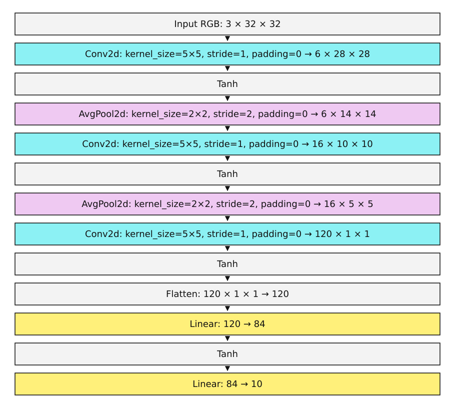
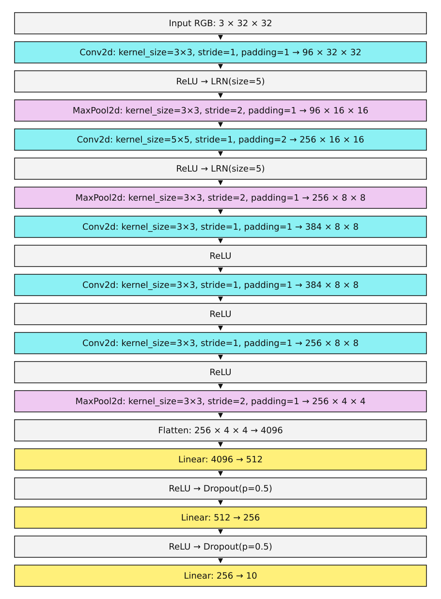

# LeNet и AlexNet: классификация изображений CIFAR-10

## О проекте

В проекте реализованы и сравнены две свёрточные нейронные сети, LeNet-5 и AlexNet, для классификации цветных изображений CIFAR-10.

Цель проекта: адаптировать обе архитектуры для цветных изображений размером 32 × 32 пикселя и сравнить качество классификации.

Архитектуры, подготовка данных и эксперименты описаны в ноутбуках. Повторяющийся код загрузки данных, обучения и получения предсказаний вынесен в `utils`.

## Данные

Используется набор данных соревнования [CIFAR-10 - Object Recognition in Images](https://www.kaggle.com/competitions/cifar-10/data) на Kaggle.

Изображения имеют размер 32 × 32 пикселя и три цветовых канала. Каждое изображение относится к одному из десяти классов: airplane, automobile, bird, cat, deer, dog, frog, horse, ship и truck.

В проекте используются:

- `train/` - изображения с известными метками классов
- `trainLabels.csv` - соответствие идентификаторов изображений и классов
- `test/` - изображения для получения предсказаний
- `sampleSubmission.csv` - образец файла предсказаний и порядок тестовых изображений

Архивы соревнования распаковываются в каталог `data/`. В ноутбуках используются изображения в формате PNG.

## Структура проекта

```text
CIFAR-10/
├── data/
│   ├── train/
│   ├── test/
│   ├── trainLabels.csv
│   └── sampleSubmission.csv
├── notebooks/
│   ├── LeNet.ipynb
│   ├── AlexNet.ipynb
│   ├── LeNet_Augmentation_Experiments.ipynb
│   └── images/
├── utils/
│   ├── data_utils.py
│   ├── train_utils.py
│   └── lenet_experiments.py
├── models/
├── results/
├── submissions/
└── README.md
```

В папке `models/` сохраняются веса моделей в файлах `.pth`. В основных ноутбуках лучшие по validation веса сохраняются в `lenet5.pth` и `alexnet.pth`, а веса после обучения на всех размеченных данных - в `lenet5_full.pth` и `alexnet_full.pth`.

`results/lenet_augmentation/` содержит таблицы и историю метрик экспериментов с аугментациями. Параметры запусков и метрики Aim хранятся локально в `.aim/`.

## Технологии

- Python
- PyTorch и torchvision
- NumPy и pandas
- Pillow
- Matplotlib
- Aim
- Jupyter Notebook / JupyterLab

## Запуск проекта

Для запуска используется Python 3.12. Данные Kaggle размещаются в `data/`, зависимости из [requirements.txt](requirements.txt) устанавливаются командой `python -m pip install -r requirements.txt`. Основные ноутбуки выполняются сверху вниз, ноутбук экспериментов с аугментациями по этапам. Интерфейс Aim запускается из корня проекта командой `aim up --repo .` и доступен по адресу [http://127.0.0.1:43800](http://127.0.0.1:43800).

## Что было сделано


### 1. Подготовка данных

Размеченные данные разделяются на обучающую и валидационную выборки в соотношении 80%/20%. Для воспроизводимости разбиения и экспериментов фиксируется `seed=52`.

Стандартизация выполняется отдельно для каждого цветового канала. Среднее значение и стандартное отклонение рассчитываются только по обучающей части и затем используются для обработки validation и test. Аугментации применяются только к обучающим изображениям.

### 2. Реализация моделей

Обе архитектуры реализованы на PyTorch и адаптированы для входных изображений CIFAR-10.


| Модель  | Основные решения адаптации                                                                                                                                                                                                                                                                                                        |
| ------- | --------------------------------------------------------------------------------------------------------------------------------------------------------------------------------------------------------------------------------------------------------------------------------------------------------------------------------- |
| LeNet-5 | - Первый свёрточный слой принимает 3 цветовых канала вместо 1. - Для классификации используется линейный выходной слой с 10 логитами.                                                                                                                                                                                             |
| AlexNet | - Первая свёртка изменена с ядра 11 × 11 и шага 4 на ядро 3 × 3 и шаг 1. - В Max Pooling добавлен `padding=1`. - Пересчитан размер входа первого линейного слоя. - Два полносвязных слоя по 4096 нейронов заменены слоями на 512 и 256 нейронов. - Число выходов уменьшено с 1000 до 10. - Убрана группировка свёрток `groups=2`. |


Описание слоёв находится в [LeNet.ipynb](notebooks/LeNet.ipynb) и [AlexNet.ipynb](notebooks/AlexNet.ipynb).


| LeNet-5                                                          | AlexNet                                                           |
| ---------------------------------------------------------------- | ----------------------------------------------------------------- |
|  |  |


### 3. Общий процесс обучения

Для обеих моделей используется общая функция обучения:

- оптимизация весов с помощью Adam и функции потерь `CrossEntropyLoss`
- вычисление loss и accuracy на train и validation после каждой эпохи
- сохранение весов с наилучшей validation accuracy
- ранняя остановка при отсутствии улучшения
- запись параметров и метрик эксперимента в Aim


### 4. Исследование аугментаций для LeNet

Для LeNet создан отдельный ноутбук с проверкой влияния различных видов аугментаций на показатели модели. У этой модели сравнительно простая архитектура, поэтому сложные аугментации из готовых стратегий для CIFAR-10 могут мешать обучению. Отдельные преобразования и их сочетания проверяются, чтобы выбрать подходящий набор для LeNet.

В [LeNet_Augmentation_Experiments.ipynb](notebooks/LeNet_Augmentation_Experiments.ipynb) сравниваются обучение без аугментаций и восемь отдельных преобразований:

- горизонтальное отражение
- случайное кадрирование с дополнением границ
- изменение яркости
- изменение контрастности
- изменение насыщенности
- поворот
- масштабирование
- случайное стирание участка изображения

Сначала отдельные преобразования сравниваются на 100 эпохах. Лучшие варианты проверяются на 300 эпохах, после чего сравниваются их сочетания. Финальные варианты обучаются до 1000 эпох с ранней остановкой.

Во всех экспериментах используются одинаковое разбиение данных, seed и начальные веса модели. Сравниваются запуски с одинаковым числом эпох. При выборе аугментаций учитываются лучшая validation accuracy и графики обучения.

### 5. Обучение на всех размеченных данных и формирование предсказаний

В обоих основных ноутбуках есть финальное обучение на всех размеченных данных. Среднее и стандартное отклонение для этого этапа рассчитываются заново по всему набору. После обучения сохраняются веса последней эпохи.

Функция `predict_submission()` формирует предсказания в формате `id,label`. Порядок изображений соответствует `sampleSubmission.csv`. Файлы сохраняются в каталоге `submissions/`.

## Результаты

Итоговое качество моделей оценивается на тестовых данных соревнования Kaggle. Для каждой модели формируется CSV с предсказаниями, который отправляется на платформу. В таблице приводится accuracy, рассчитанная Kaggle для отправленного файла.


| Модель | Аугментации | Kaggle accuracy |
| --- | --- | --- |
| LeNet-5 | Crop + horizontal flip + rotation | 69,95% |
| AlexNet | AutoAugment CIFAR-10 | 86,87% |
